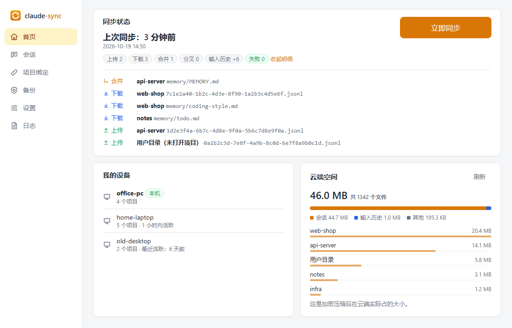
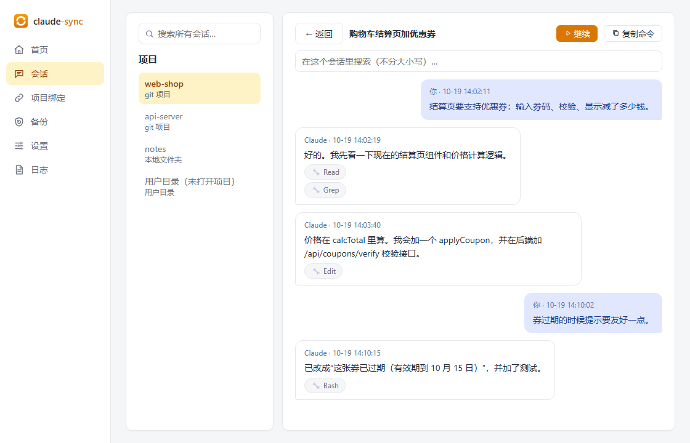
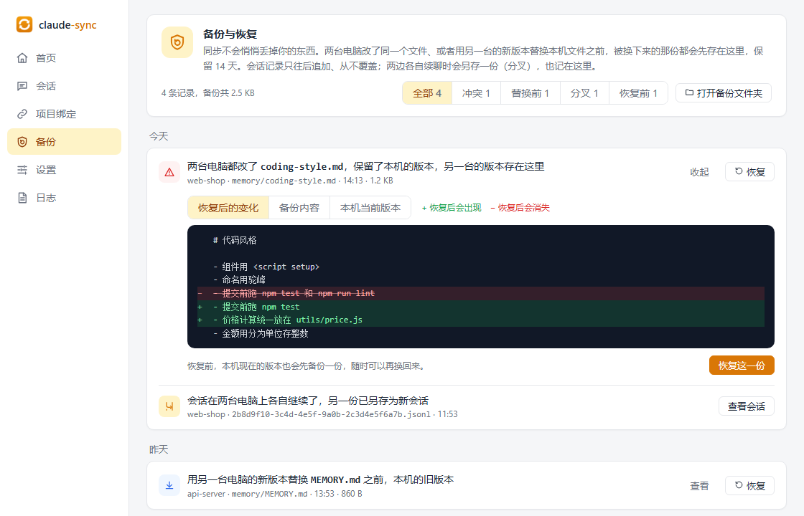
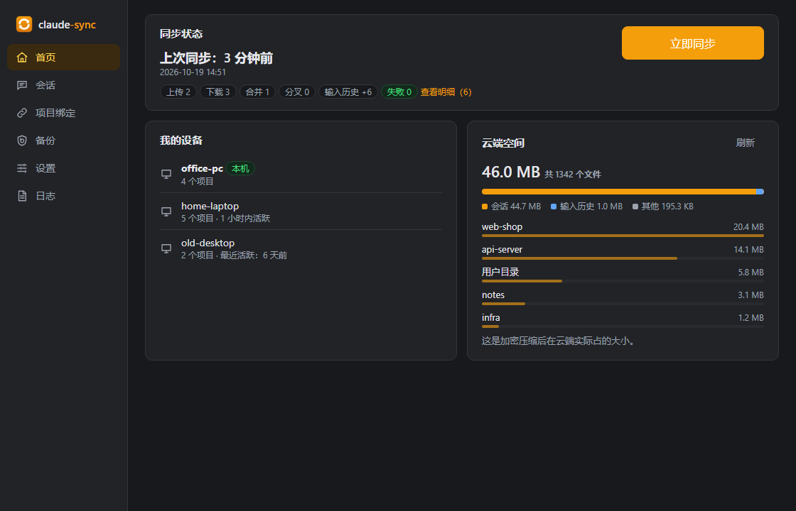

<div align="center">


# agent-sync

**在多台电脑（Windows / macOS）之间同步 Claude Code 和 Codex 的会话记录、个人规则和技能。端到端加密，路径自动翻译，换台电脑 `claude --resume` 接着聊。**

[](https://github.com/ALFO111111/agent-sync/releases)
[](https://github.com/ALFO111111/agent-sync/actions/workflows/ci.yml)
[](LICENSE)


简体中文 | [English](README_EN.md)

</div>

> [!NOTE]
> 这是社区开发的**非官方**工具，与 Anthropic、OpenAI 没有任何关系。“Claude” 是 Anthropic 的商标，“Codex” 是 OpenAI 的商标。
>
> 0.4.0 起由 **claude-code-sync** 改名为 **agent-sync**（不只同步 Claude Code 了）。旧版本在“设置 → 关于”里点更新就能直接升级，数据、口令、云端内容都不用动，见[从旧版本升级](#rename)。

<p align="center"></p>

<details>
<summary><b>更多截图</b>（会话浏览、备份与恢复、深色模式）</summary>
<br />
<p align="center"></p>
<p align="center"></p>
<p align="center"></p>
<p align="center"><sub>截图里的设备、项目、路径都是演示数据（<code>cd frontend && npm run demo</code>）。</sub></p>
</details>

## 为什么需要它

Claude Code 的会话记录存在本机的 `~/.claude/projects/` 里。家里一台、公司一台电脑时，在 A 上聊到一半的会话，在 B 上就看不到了。

直接拷文件也不行：两台电脑上同一个项目的路径往往不一样（`D:\work\app` 和 `E:\code\app`），而会话里到处都写着绝对路径，拷过去之后 `--resume` 对不上号。

agent-sync 专门解决这个问题：

- **会话同步**：`~/.claude/projects` 下的会话、子代理记录、项目记忆（MEMORY.md），外加输入历史（按 ↑ 翻到的那些）
- **Claude Code 个人配置同步**：全局规则 `CLAUDE.md`、计划 `plans/`、技能 `skills/`、子代理 `agents/`、自定义命令 `commands/`、任务 `tasks/`、用户级 MCP 服务器，以及 settings.json 里的几个安全字段（语言、自动记忆、署名）。模型、API Key、hooks、权限、MCP 里的密钥和环境变量**都不上传**。设置页可以逐类开关
- **Codex 会话、规则与技能**：同步 Codex 会话（`$CODEX_HOME/sessions`，默认 `~/.codex`），换台电脑接着聊；还有全局规则 `AGENTS.md`、`AGENTS.override.md`、技能 `~/.agents/skills` 和旧位置的 `$CODEX_HOME/skills`。与 Claude 分开开关，复用同一套加密、合并、冲突和备份机制，具体范围和限制见[下文](#codex-scope)
- **路径自动翻译**：A 电脑的 `D:\work\app` 拉到 B 电脑时自动换成 `E:\code\app`，`claude --resume` 直接能用；Windows 和 Mac 之间也行（`D:\code\x\src\a.go` ↔ `/Users/me/code/x/src/a.go`）
- **项目自动对上**：git 项目按远程仓库地址自动匹配（ssh / https 写法都认）；普通文件夹在界面上点一下“认领”
- **端到端加密**：上传前用你的口令加密（Argon2id + AES-256-GCM），云端只看得到乱码
- **不丢数据**：会话只往末尾追加、从不整份覆盖；两台电脑各自续聊了同一个会话时，两份都保留（另一份存为新会话）；其他文件被替换前先备份，在“备份”页对比后一键恢复
- **全自动**：开机自动在后台运行（Windows 在托盘里，Mac 是无窗口的后台进程），文件一变就同步；Claude Code 每次对话开始和回复结束时同步当前项目；另外每小时全量兜底一次
- **会话浏览**：按标题列出每个项目的会话，跨项目搜索聊天内容，一键在终端里 `claude --resume` 接着聊
- **随时改口令**：所有云端文件用新口令重新加密，其他电脑输入新口令后接着同步
- **用你自己的存储**：任何 S3 兼容的对象存储都行：阿里云 OSS、腾讯云 COS、Cloudflare R2、AWS S3、MinIO（自建/NAS）……
- **图形界面 + 命令行**：Windows 是单个 exe，免安装；Mac 是 DMG 安装包，拖进“应用程序”即可；界面支持简体中文和 English

## 支持的系统

| 系统 | 要求 |
|---|---|
| **Windows 10 / 11**（64 位） | 图形界面依赖 WebView2，Windows 11 自带；Windows 10 一般也已经装好，没有的话程序会提示安装 |
| **macOS 13 及以上** | 只支持 Apple 芯片（M1 及以后），不支持 Intel 芯片的 Mac |

Claude Code 和 Codex 在两个系统上都支持，Windows 和 Mac 之间可以互相同步。Linux 暂不支持。

## 下载

### Windows

到 [Releases](https://github.com/ALFO111111/agent-sync/releases) 下载 `agent-sync.exe`，放到一个**固定的位置**，比如 `%LOCALAPPDATA%\Programs\agent-sync\`。自动同步会记住 exe 的路径；以后挪了位置也没关系，打开一次程序就会自动改过来。

> [!IMPORTANT]
> exe 没有做代码签名（个人开源项目，签名证书的费用承担不起）。第一次双击时 Windows 可能弹出“Windows 已保护你的电脑”，点 **更多信息 → 仍要运行** 即可。这只是 Windows 对未购买签名证书的软件的通用提示，不代表软件有问题。
> 不放心的话可以：用 Releases 里的 `SHA256SUMS.txt` 核对文件、审计源码，或者[自己从源码编译](CONTRIBUTING.md)。

### macOS

到 [Releases](https://github.com/ALFO111111/agent-sync/releases) 下载 `agent-sync-<版本>-macos-arm64.dmg`，双击打开，把 `agent-sync.app` 拖到旁边的“应用程序”（Applications）图标上，然后在“访达”侧边栏推出这个 DMG。

> [!IMPORTANT]
> App 没有经过 Apple 公证（只有 ad-hoc 自签名，原因同上），第一次打开会被 Gatekeeper 拦下。任选一种方式放行（只需要第一次）：
> - macOS 15 及以上：先双击一次 App（会被拦下），然后打开 **系统设置 → 隐私与安全性**，在页面下方点 **仍要打开**，输入开机密码确认
> - macOS 13 / 14：在“访达”里**右键** App → **打开**，再在弹窗里点“打开”
> - 或者在终端运行：
>   ```bash
>   xattr -dr com.apple.quarantine /Applications/agent-sync.app
>   ```
>
> 同样可以用 `SHA256SUMS.txt` 核对 dmg。

**和 Windows 版的区别**：

- Mac 版**没有菜单栏图标**（托盘库和 Wails 在 macOS 上冲突），关闭窗口就是退出程序。后台同步不受影响：登录时会自动启动一个没有窗口的后台进程（`agent-sync daemon`）负责实时同步，见下文的[同步触发](#triggers)。
- 命令行要用 App 里面的可执行文件，例如：
  ```bash
  /Applications/agent-sync.app/Contents/MacOS/agent-sync sync
  ```
  嫌长的话可以加个别名：`alias agent-sync=/Applications/agent-sync.app/Contents/MacOS/agent-sync`

### 更新

打开程序时会自动去 GitHub 看有没有新版本（之后每天一次），有的话侧边栏“设置”上出现红点。到 **设置 → 关于** 点“更新到 vX.Y.Z”：自动下载、按 `SHA256SUMS.txt` 校验、替换、重新打开，会话和配置都不受影响。点“以后再说”这个版本就不再提醒。

- Windows 替换的是 exe 本身，放在需要管理员权限的目录（如 `C:\Program Files`）里没法自动更新，所以推荐放在 `%LOCALAPPDATA%\Programs\`。
- Mac 替换的是“应用程序”里的整个 App，后台进程也会一起换成新版本。
- 国内连 GitHub 不稳定：程序会用系统代理（Clash 等开了“系统代理”就行）。实在连不上就到 Releases 手动下载。

<a id="rename"></a>
### 从旧版本（claude-code-sync）升级

0.3.x 及以前叫 claude-code-sync。在旧版本里点“更新”（或运行 `claude-code-sync update`）就能升到 agent-sync，不用重新初始化。如果提示“没有可以自动安装的版本”（0.4.1 之后的发布不再带旧文件名），到 Releases 下载新版本放好、打开一次即可，效果一样：

- 程序还在原来的位置、用原来的文件名（比如 `claude-code-sync.exe`、`/Applications/claude-code-sync.app`），只是里面换成了新版本。想换成新名字的话，退出程序后按上面的方式下载新版本放好，再打开一次就行，自动同步会自动改到新位置。
- 数据目录**继续用原来的 `~/.claude-code-sync`**，不搬家；新装的电脑才用 `~/.agent-sync`。
- 云端数据格式、口令都没变，新旧版本可以混着用，各台电脑不用同时升级。
- 自动同步（定时任务、开机自启、Mac 的后台进程）会换成新名字，旧名字的那些自动删掉；Claude Code hooks 会改成指向新程序。

## 5 分钟上手

> [!WARNING]
> **第一次使用前先备份会话。** 工具从不删除你的会话文件，但数据是你的，备份一下总没错：
> ```powershell
> robocopy "$env:USERPROFILE\.claude" "D:\claude-backup" /E      # Windows
> ```
> ```bash
> cp -Rp ~/.claude ~/claude-backup                                # macOS（用 Codex 的话 ~/.codex 也备份一份）
> ```

1. **准备一个对象存储 bucket 和一对访问密钥**：按下面的[云端存储开通教程](#cloud-storage-setup)来，大约 3 分钟。
2. **第一台电脑**：打开程序（Windows 双击 `agent-sync.exe`，Mac 打开 `agent-sync.app`），向导一共 4 步：设备名 → 选服务商 → 填 bucket 和密钥（可以点“测试连接”）→ 设同步口令。点“完成”后会自动开启同步，并立即同步一次。
3. **第二台电脑**：同样下载、双击，填**同一个 bucket**、输入**同一个口令**。完成后会把第一台电脑的会话拉下来。
4. **对上项目**：
   - git 项目（有远程仓库地址）会自动对上，不用管
   - 普通文件夹：打开“项目绑定”页，在“待认领”里点“认领”，选本机对应的目录
   - 没打开项目、直接在用户目录里聊的会话，会自动对上另一台电脑的用户目录
5. **换电脑接着聊**：在对应项目目录里运行 `claude --resume`，就能看到另一台电脑上的会话；也可以在程序的“会话”页找到它，点“继续”。Codex 会话在 VS Code 插件、Codex 桌面版的会话列表里能直接看到（命令行的注意事项见[下文](#codex-scope)）。

> [!TIP]
> 会话同步了，**代码也要同步**（用 git）。换电脑前提交、推送，不然 AI 看到的聊天记录和代码会对不上。

<a id="cloud-storage-setup"></a>

## 云端存储开通教程

所有服务商都一样，只需要两样东西：

1. 一个**私有**的 bucket（不要开公共读）
2. 一对**只能访问这个 bucket** 的访问密钥（AccessKey）。不要用主账号的密钥。

所有电脑必须填**同一个 bucket、同一个路径前缀**（默认 `v1/`）。这就是它们的“接头地点”。

<details>
<summary><b>阿里云 OSS</b>（国内推荐）</summary>

1. [OSS 控制台](https://oss.console.aliyun.com/) → 创建 Bucket：读写权限选 **私有**，记下地域（例如“华东2（上海）”对应 `cn-shanghai`）。
2. [RAM 访问控制](https://ram.console.aliyun.com/) → 用户 → 创建用户，勾选“使用永久 AccessKey 访问”，保存 AccessKey ID 和 Secret。
3. 权限策略 → 创建自定义策略（把 `your-bucket` 换成你的 bucket 名），然后授权给这个用户：

   ```json
   {
     "Version": "1",
     "Statement": [
       {
         "Effect": "Allow",
         "Action": ["oss:ListObjects", "oss:GetObject", "oss:PutObject"],
         "Resource": ["acs:oss:*:*:your-bucket", "acs:oss:*:*:your-bucket/*"]
       }
     ]
   }
   ```
4. 程序里选 **阿里云 OSS**，地域填 `cn-shanghai`（按你的实际地域），Endpoint 留空即可。

</details>

<details>
<summary><b>腾讯云 COS</b></summary>

1. [COS 控制台](https://console.cloud.tencent.com/cos) → 创建存储桶：访问权限选 **私有读写**，记下完整名称（形如 `mybucket-1250000000`）和地域（如 `ap-shanghai`）。
2. [访问管理 CAM](https://console.cloud.tencent.com/cam) → 新建子用户，访问方式选“编程访问”，保存 SecretId 和 SecretKey。
3. 回到存储桶 → 权限管理 → 存储桶访问权限 → 添加用户，选刚才的子用户，勾选 **数据读取、数据写入**。
4. 程序里选 **腾讯云 COS**，地域填 `ap-shanghai`，Bucket 填完整名称（带 `-1250000000`），SecretId / SecretKey 填到 AccessKeyId / AccessKeySecret。

</details>

<details>
<summary><b>Cloudflare R2</b>（海外推荐，免费 10GB、不收流量费）</summary>

1. Cloudflare 控制台 → R2 → Create bucket。
2. R2 → Manage R2 API Tokens → Create API token：权限选 **Object Read & Write**，范围限定到这个 bucket。
3. 保存页面上显示的 Access Key ID、Secret Access Key，以及 S3 地址 `https://<账户ID>.r2.cloudflarestorage.com`。
4. 程序里选 **Cloudflare R2**，Endpoint 填上面的地址，地域留空。

</details>

<details>
<summary><b>AWS S3</b></summary>

1. 创建 bucket，保持 “Block all public access” 开启。
2. IAM → 创建用户，附加下面的内联策略（换成你的 bucket 名），再为它创建访问密钥：

   ```json
   {
     "Version": "2012-10-17",
     "Statement": [
       { "Effect": "Allow", "Action": "s3:ListBucket", "Resource": "arn:aws:s3:::your-bucket" },
       { "Effect": "Allow", "Action": ["s3:GetObject", "s3:PutObject"], "Resource": "arn:aws:s3:::your-bucket/*" }
     ]
   }
   ```
3. 程序里选 **AWS S3**，地域填 bucket 所在地域（如 `us-east-1`）。

</details>

<details>
<summary><b>MinIO（自建服务器 / NAS）及其他 S3 兼容服务</b></summary>

- **MinIO**：Endpoint 填 `http://你的服务器:9000`，勾选“使用路径风格 URL”。建议给它单独建一个只能读写这个 bucket 的用户。
- **其他服务**（Backblaze B2、Wasabi、七牛等）：选“其他 S3 兼容服务”，按服务商文档填 Endpoint 和地域。

</details>

## 它是怎么工作的

```
电脑 A                          你的对象存储（只有密文）                     电脑 B
~/.claude/projects  ──加密上传──▶  v1/files/...  v1/devices/...  ──下载解密──▶  ~/.claude/projects
D:\work\app                       v1/history.jsonl                           翻译成 E:\code\app
```

- **项目身份证**：每个项目有一个跨设备不变的 ID。git 项目用远程仓库地址；没有 git 的文件夹由你认领一次。之后路径按这个对应关系精确替换，不靠猜。
- **只翻译该翻译的**：只改记录里 `cwd`、`file_path` 这类“整个值就是路径”的字段；聊天正文里提到的路径原样保留。
- **云端存原样、本机翻译**：云端存的是原始内容，拉到哪台电脑就翻译成哪台电脑的路径。
- **冲突处理**：

  | 情况 | 怎么办 |
  |---|---|
  | 只有一边改了 | 正常上传或下载 |
  | 两边都改了同一个会话，一边是另一边的“前半段” | 取更完整的那份：只把缺的记录追加到本机文件末尾，从不整份覆盖（Claude Code 正在写也不会吞掉它刚写的那句） |
  | 两边各自续聊出了不同内容 | 都保留：另一份存成新会话 |
  | 项目记忆 MEMORY.md 两边都改了 | 按行合并 |
  | 其他文件两边都改了 | 本机优先，另一台的版本进备份 |
  | 其他文件只有另一台改了 | 下载，替换前本机的旧版本进备份 |
  | Claude Code 自己清理掉的旧会话 | 不会被重新拉回来 |

  备份在 `~/.agent-sync/backup/`，保留 14 天。程序的“备份”页可以查看、和本机现在的版本逐行对比、一键恢复（恢复前的版本也会先备份，可以再换回来）。

- **个人配置（规则、技能、MCP 等）的合并**：记住“上次两边一致时的样子”，做三方合并。两台电脑改了不同的行 / 不同的字段 → 自动合并；改到同一处 → 进“冲突”页，本机文件保持原样能用，等你选“保留本机 / 用另一台的 / 两份都留 / 手工合并”。**删除不会传播**：一台电脑上删掉的文件，不会去删另一台的，也不会在本机被拉回来。
- **和 CC Switch 一起用**：CC Switch 负责供应商地址、Key、模型；如果它的自动同步开着，Claude 的全局规则、技能、MCP 可能被两边重复同步，这三类会先暂停，在设置页选一个负责（CC Switch 没开自动同步就不会打扰你）。这个负责人选择只影响 Claude，不会暂停或接管 Codex。

<a id="triggers"></a>

- **四层触发**：
  1. Claude Code hooks（`SessionStart` / `Stop`）是主力，Windows 和 Mac 一样
  2. 盯文件变化，一改就同步：Windows 上是开机自启、在托盘常驻的程序；Mac 上是登录时由 launchd 启动的无窗口后台进程 `agent-sync daemon`（LaunchAgent `com.alfo111111.agent-sync.daemon`）。设置页的“开机自启”开关控制它们
  3. 每小时全量兜底一次：Windows 用定时任务；Mac 用 LaunchAgent `com.alfo111111.agent-sync.sync`（登录时也跑一次）。Mac 上的两个 LaunchAgent 都在 `~/Library/LaunchAgents`，只属于当前用户，不需要管理员权限
  4. 随时手动点“立即同步”

<a id="codex-scope"></a>

### Codex 同步什么

| 本机内容 | 类别 | 云端对象（默认前缀 `v1/`） |
|---|---|---|
| `$CODEX_HOME/sessions/**/rollout-*.jsonl`（会话；未设置 `CODEX_HOME` 时为 `~/.codex`） | `sessions` | `v1/tools/codex/sessions/<设备ID>/...` |
| `$CODEX_HOME/AGENTS.md` 和 `$CODEX_HOME/AGENTS.override.md` | `rules` | `v1/tools/codex/files/rules/...` |
| `~/.agents/skills/` | `skills` | `v1/tools/codex/files/skills/...` |
| `$CODEX_HOME/skills/`（旧位置的技能，Codex 仍会读取；不含 Codex 自带的 `.system`） | `legacy-skills` | `v1/tools/codex/files/legacy-skills/...` |

四类默认都开，可以在设置页或用 `content disable codex <类别>` 逐类关闭；Claude 与 Codex 的开关互不影响，CC Switch 的负责人选择也只影响 Claude。规则和技能复用同一套端到端加密、三方文本合并、冲突解决、备份恢复和删除不传播机制；`sync --dry` 和修改口令也包含 Codex 的全部内容。

**Codex 会话是怎么同步的**：

- **只同步 rollout 文件**。Codex 的 SQLite（`state_*.sqlite`、`thread_history_*.sqlite` 等）都是它自己能从 rollout 重建的索引，不同步。
- **云端按设备分开存**：每台电脑只写自己那份，不会互相覆盖。
- **另一台接着聊**：只把多出来的行追加到本机文件末尾。
- **两台各自续写了同一个会话**：对方那份另存成一个新会话（新 ID 由原 ID 和对方设备决定，之后对方再续写，就追加进这一份）。
- **Codex 正开着这个会话**：追加前会先拿 Codex 自己的会话写锁（`thread-writer-locks/<ID>.lock`），拿不到就本轮跳过，下次再来。
- **本机删掉或归档的会话**不会被重新拉回来。
- **路径翻译和项目绑定**：会话所在的目录和 Claude 一样参与项目绑定（git 项目自动对上，普通文件夹要在另一台“认领”）。项目在本机还没对上（待认领）时，会话先留在云端，对上以后自动拉下来。

**限制**：

- **命令行 `codex resume` 的选择器只查本机数据库**，拉下来的会话可能不在列表里。可以直接用 `codex resume <会话ID>`，或者先打开一次 VS Code 插件 / Codex 桌面版（它们的会话列表会自动认出新会话）。
- **恢复时目标电脑要有同名的模型供应商**（model provider，比如 CC Switch 写进 `config.toml` 的 `custom`）。本工具不同步 `config.toml`。
- **Codex 桌面版里的分组归属会丢**：分组信息不随会话同步，拉过来的会话需要在桌面版里重新归组。
- **不同步**：`history`、`session_index`、SQLite/WAL 数据库、`config.toml`（包括 MCP）、`auth` / 登录凭据、插件、hooks。项目目录里的 AGENTS / skills 仍由 Git 管理，不在同步范围内。

## 命令行

同一个程序，带参数就是命令行模式（Mac 上用 `/Applications/agent-sync.app/Contents/MacOS/agent-sync`，或者按上文加个别名）：

```powershell
agent-sync init                       # 命令行版初始化（和图形向导一样）
agent-sync sync                       # 双向同步一次
agent-sync sync --dry                 # 只看会做什么，不改任何东西
agent-sync status                     # 查看绑定情况和待认领项目
agent-sync claim <项目ID> <本机路径>   # 认领其他电脑上的项目
agent-sync ignore <项目ID>             # 忽略 / 停止同步一个项目（不删文件）
agent-sync unignore <项目ID>           # 取消忽略
agent-sync content                    # 查看哪些个人配置在同步
agent-sync content disable skills     # 关掉一类 Claude 配置（不删文件）；enable 打开，旧写法保留
agent-sync content disable codex sessions # 只关 Codex 会话；enable 打开，类别为 rules / skills / legacy-skills / sessions
agent-sync content owner mcp sync     # CC Switch 也开着自动同步时，选谁负责 Claude 配置（sync / ccswitch）
agent-sync conflicts                  # 列出待处理的冲突
agent-sync resolve <冲突ID> local     # 解决冲突：local / remote / both，或 merged <文件>
agent-sync restore-content plans a.md # 本机删掉的 Claude 配置文件，从云端拉回来（旧写法保留）
agent-sync restore-content codex rules AGENTS.md # 拉回 Codex 全局规则；类别为 rules / skills / legacy-skills
agent-sync passwd                     # 修改同步口令；别的电脑改过口令后，在本机输入新口令
agent-sync uninstall                  # 删除自动同步（hooks + 定时任务 + 开机自启；Mac 上是两个 LaunchAgent）
agent-sync version
agent-sync update                     # 检查更新，有新版本就下载安装（--dry 只检查）
```

## 常见问题

<details>
<summary><b>多台电脑能共用一个 bucket 吗？</b></summary>

不但能，而且**必须**共用。电脑之间没有直接通信，全靠同一个 bucket 碰头。bucket 和路径前缀不一致的话，等于没同步。不同的云账号、不同的密钥都可以，只要指向同一个 bucket。
</details>

<details>
<summary><b>怎么修改同步口令？</b></summary>

在“设置 → 同步口令”里点“修改口令”（或运行 `agent-sync passwd`）。程序会把云端的全部文件用新口令重新加密，文件多的话要几分钟；万一中途断了，用同样的口令再来一次就行。

改完之后，其他电脑会暂停同步（不会用旧口令接着上传），打开程序首页会提示输入新口令，输入后继续。
</details>

<details>
<summary><b>口令忘了怎么办？</b></summary>

口令无法找回（云端数据就是用它加密的）。可以在每台电脑上重新初始化、设一个新口令，同时把 bucket 里的 `v1/` 目录清空，从头开始。本机的会话不受影响。
</details>

<details>
<summary><b>和 CC Switch 一起用会冲突吗？</b></summary>

不会。CC Switch 切换供应商时可能会改写 `~/.claude/settings.json`，把本工具的 hooks 抹掉。本工具发现后会在几秒内自动补回（Windows 上程序在托盘里开着时，Mac 上后台进程在运行时），或者在下一次每小时同步时补回。
</details>

<details>
<summary><b>我的数据存在哪里？AccessKey 安全吗？</b></summary>

- 配置：`~/.agent-sync/config.json`（Windows 上是 `%USERPROFILE%\.agent-sync\config.json`；从 claude-code-sync 升级上来的电脑是 `.claude-code-sync` 目录）。AccessKey 以明文保存在这个文件里（在你的用户目录下，默认只有你的系统账户和管理员能读），所以请使用**只能访问这一个 bucket** 的子账号密钥。
- 加密密钥：同目录的 `key` 文件（由口令推导而来）
- 日志：同目录的 `sync.log`，也可以在程序的“日志”页查看
- 云端只保存加密后的数据，服务商看不到会话内容。
</details>

<details>
<summary><b>旧版本用的是阿里云 OSS 专用配置，升级后要重新设置吗？</b></summary>

不用。旧配置会自动转换成 S3 兼容写法，指向同一个 bucket，已经同步过的文件也不会重新下载。
</details>

<details>
<summary><b>怎么卸载？</b></summary>

**Windows**：

1. 运行 `agent-sync uninstall`，删除 Claude Code hooks、Windows 定时任务和开机自启（会话、配置、云端数据都不动）
2. 在托盘图标上右键 → 退出
3. 删除 exe 和 `%USERPROFILE%\.agent-sync` 目录（从旧版本升级上来的电脑是 `.claude-code-sync`）
4. 云端数据：在服务商控制台删除 bucket 里的 `v1/` 目录

**macOS**：

1. 运行 `/Applications/agent-sync.app/Contents/MacOS/agent-sync uninstall`，删除 Claude Code hooks 和 `~/Library/LaunchAgents` 里的两个 LaunchAgent（`com.alfo111111.agent-sync.sync`、`com.alfo111111.agent-sync.daemon`），后台进程随之停止（会话、配置、云端数据都不动）
2. 关闭 App 窗口，把 `agent-sync.app` 拖到废纸篓
3. 删除 `~/.agent-sync` 目录（从旧版本升级上来的电脑是 `~/.claude-code-sync`）
4. 云端数据：同上
</details>

## 安全与隐私

- 会话内容在本机加密后才上传：口令经 Argon2id 推导出 256 位密钥，内容 gzip 压缩后用 AES-256-GCM 加密，对象路径作为附加数据防止调包。
- 程序只和**你自己配置的**对象存储通信，没有任何遥测、统计。唯一的例外是**检查更新**：打开程序时和之后每天一次，向 GitHub 问一下最新版本号（`api.github.com`，不带任何个人信息），点“更新”时才从 GitHub 下载安装包。不想要的话在“设置 → 通用”里关掉“自动检查更新”。
- 发现安全问题请看 [SECURITY.md](SECURITY.md)，不要直接发公开 issue。

## 参与开发

欢迎提 issue 和 PR！开发环境、项目结构、发布流程见 [CONTRIBUTING.md](CONTRIBUTING.md)。

## 许可证

[MIT](LICENSE) © ALFO111111
