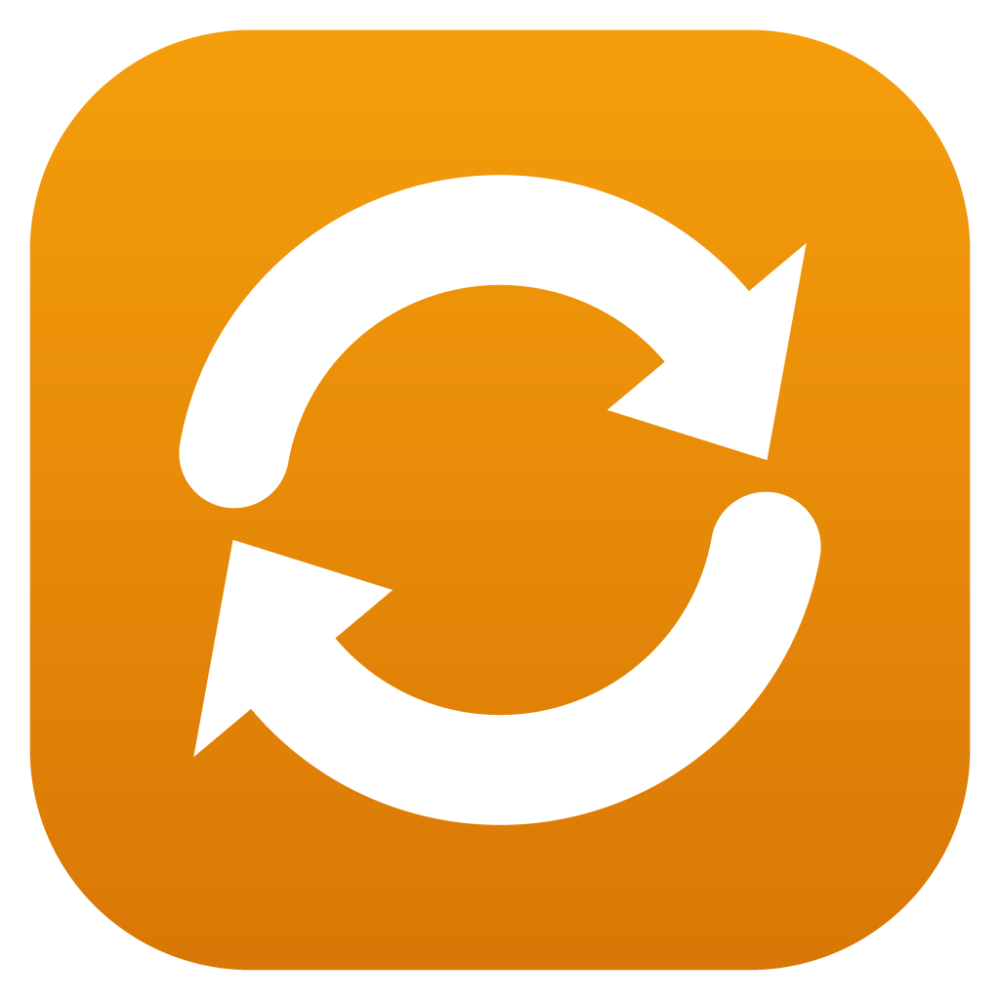
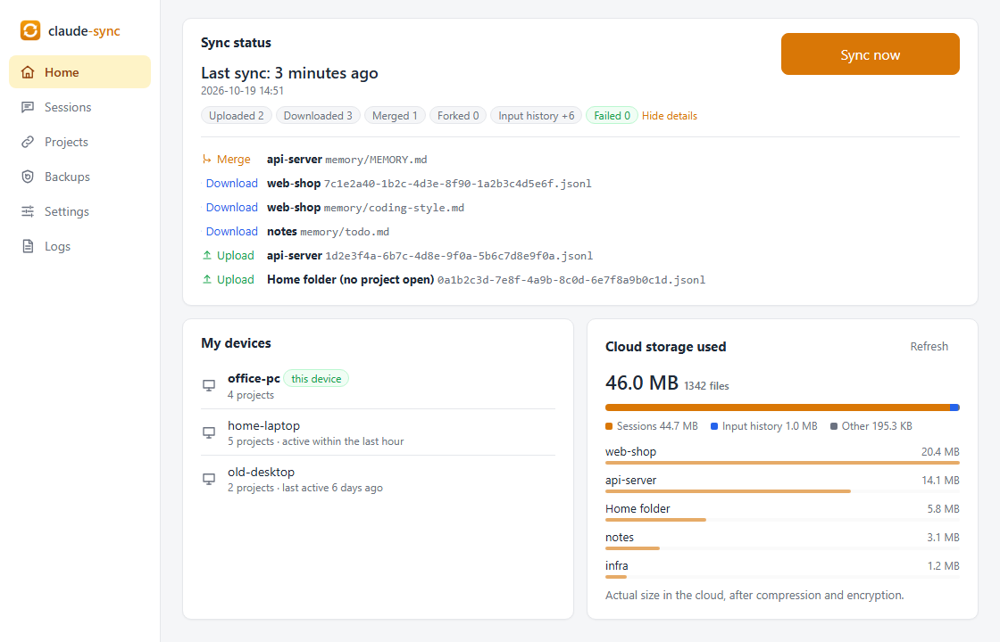
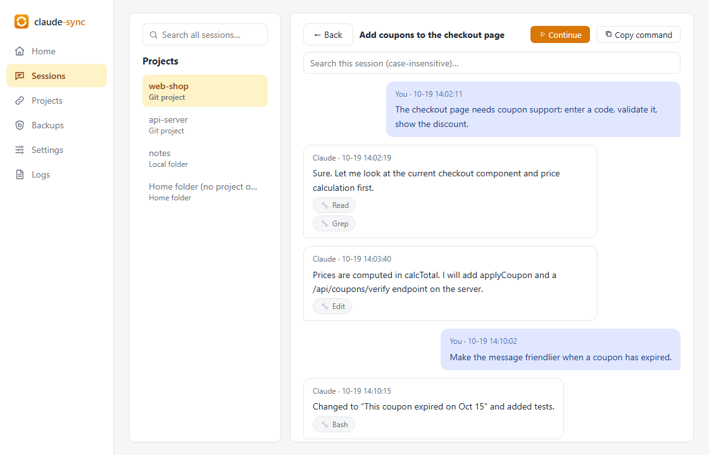
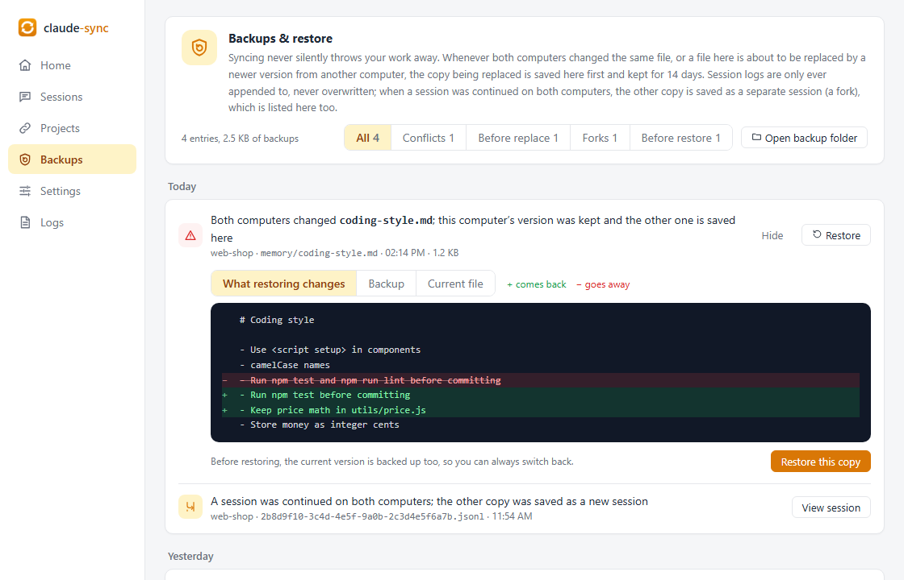
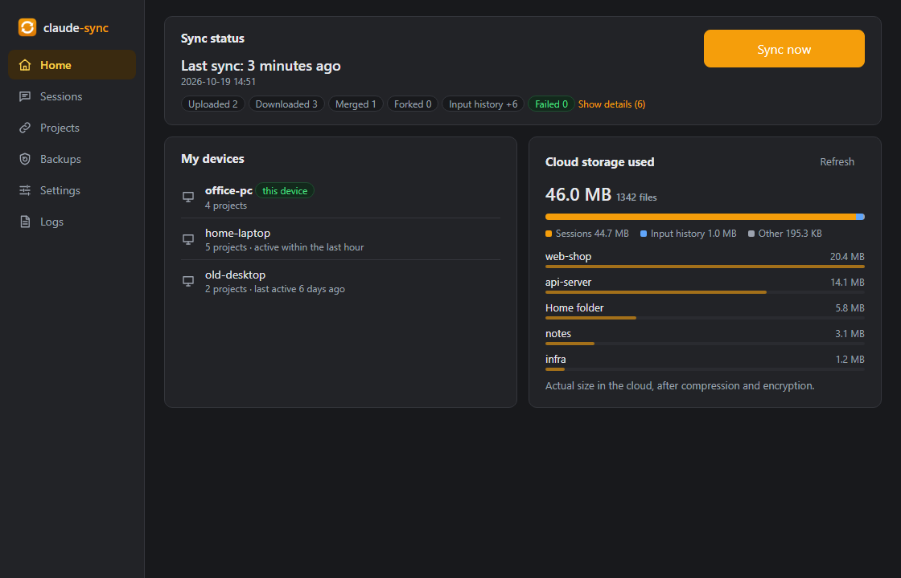

<div align="center">



# claude-code-sync

**Sync Claude Code and Codex sessions, personal rules and skills across machines (Windows / macOS). End-to-end encrypted, with paths translated automatically: switch computers and `claude --resume` right where you left off.**

[](https://github.com/ALFO111111/claude-code-sync/releases)
[](https://github.com/ALFO111111/claude-code-sync/actions/workflows/ci.yml)
[](LICENSE)


[简体中文](README.md) | English

</div>

> [!NOTE]
> This is an **unofficial** community tool and is not affiliated with Anthropic in any way. "Claude" is a trademark of Anthropic.

<p align="center"></p>

<details>
<summary><b>More screenshots</b> (session browser, backups & restore, dark mode)</summary>
<br />
<p align="center"></p>
<p align="center"></p>
<p align="center"></p>
<p align="center"><sub>Devices, projects and paths in the screenshots are demo data (<code>cd frontend && npm run demo</code>).</sub></p>
</details>

## Why

Claude Code keeps your sessions in `~/.claude/projects/` on the local machine. If you work on a desktop at home and a laptop at the office, a conversation started on one is invisible on the other.

Copying the files over doesn't work either: the same project usually lives at different paths on each machine (`D:\work\app` vs `E:\code\app`), and sessions are full of absolute paths, so `--resume` can't match them up.

claude-code-sync solves exactly that:

- **Session sync**: sessions, sub-agent transcripts and project memory (MEMORY.md) under `~/.claude/projects`, plus your input history (what ↑ brings back)
- **Claude Code personal config sync**: global rules `CLAUDE.md`, `plans/`, `skills/`, `agents/`, `commands/`, `tasks/`, user-level MCP servers, and a few safe fields from settings.json (language, auto memory, co-author line). Models, API keys, hooks, permissions and MCP secrets/env vars are **never uploaded**. Each category can be turned off in Settings
- **Codex sessions, rules and skills**: sync Codex sessions (`$CODEX_HOME/sessions`, `~/.codex` by default) so you can continue on another machine, plus global rules `AGENTS.md`, `AGENTS.override.md`, skills in `~/.agents/skills` and the legacy `$CODEX_HOME/skills`. Switches are independent from Claude, with the same encryption, merge, conflict and backup machinery; see the exact scope and limitations [below](#codex-scope)
- **Automatic path translation**: `D:\work\app` on machine A becomes `E:\code\app` on machine B, so `claude --resume` just works; between Windows and Mac too (`D:\code\x\src\a.go` ↔ `/Users/me/code/x/src/a.go`)
- **Projects match up by themselves**: git projects are matched by remote URL (ssh and https forms alike); plain folders are claimed with one click
- **End-to-end encryption**: everything is encrypted with your passphrase before upload (Argon2id + AES-256-GCM); the cloud only sees ciphertext
- **No data loss**: sessions are only ever appended to, never overwritten wholesale; if the same session was continued on two machines, both versions are kept (one is saved as a new session); any other file is backed up before it is replaced, and the Backups page lets you compare and restore with one click
- **Fully automatic**: starts at login and runs in the background (in the tray on Windows, as a windowless background process on the Mac), syncing as soon as files change; syncs the current project whenever a Claude Code conversation starts or a reply finishes; plus a full sync every hour as a safety net
- **Session browser**: sessions listed by title for every project, search across all projects, and continue any session with `claude --resume` in a terminal with one click
- **Change the passphrase any time**: every cloud file is re-encrypted with the new passphrase; other machines continue once you enter it there
- **Bring your own storage**: any S3-compatible object storage: Cloudflare R2, AWS S3, Alibaba Cloud OSS, Tencent Cloud COS, MinIO (self-hosted / NAS), …
- **GUI + CLI**: a single portable exe on Windows, a DMG on the Mac (drag to Applications); the interface is available in English and Simplified Chinese

## Supported systems

| System | Requirements |
|---|---|
| **Windows 10 / 11** (64-bit) | The GUI uses WebView2, which ships with Windows 11 and is usually present on Windows 10; if it's missing the app will offer to install it |
| **macOS 13 or later** | Apple silicon (M1 or later) only; Intel Macs are not supported |

Claude Code and Codex are supported on both, and Windows and Mac machines can sync with each other. Linux is not supported yet.

## Download

### Windows

Grab `claude-code-sync.exe` from [Releases](https://github.com/ALFO111111/claude-code-sync/releases) and put it in a **permanent location**, e.g. `%LOCALAPPDATA%\Programs\claude-code-sync\`. Automatic sync remembers where the exe is; if you move it later, just open the app once and the path is fixed for you.

> [!IMPORTANT]
> The executables are not code-signed — this is a personal open-source project and a signing certificate costs more than it can afford. On the first launch Windows may show "Windows protected your PC"; click **More info → Run anyway**. This is Windows' generic warning for any unsigned software, not an indication of a problem.
> If you'd rather not take that on faith: verify the download against `SHA256SUMS.txt` in the release, audit the source, or [build it yourself](CONTRIBUTING.md).

### macOS

Download `claude-code-sync-<version>-macos-arm64.dmg` from [Releases](https://github.com/ALFO111111/claude-code-sync/releases), open it, drag `claude-code-sync.app` onto the Applications icon next to it, then eject the DMG from the Finder sidebar.

> [!IMPORTANT]
> The app is not notarized by Apple (it only has an ad-hoc signature, for the same reason as above), so Gatekeeper blocks the first launch. Allow it once in any of these ways:
> - macOS 15 or later: double-click the app once (it gets blocked), then open **System Settings → Privacy & Security**, click **Open Anyway** near the bottom and confirm with your login password
> - macOS 13 / 14: **right-click** the app in Finder → **Open**, then click "Open" in the dialog
> - or run this in Terminal:
>   ```bash
>   xattr -dr com.apple.quarantine /Applications/claude-code-sync.app
>   ```
>
> You can verify the dmg against `SHA256SUMS.txt` as well.

**Differences from the Windows version**:

- There is **no menu bar icon** on the Mac (the tray library and Wails conflict on macOS), so closing the window quits the app. Background sync keeps working: a windowless background process (`claude-code-sync daemon`) is started at login and syncs in real time; see [triggers](#triggers) below.
- For the command line, use the executable inside the app, e.g.:
  ```bash
  /Applications/claude-code-sync.app/Contents/MacOS/claude-code-sync sync
  ```
  If that's too long, add an alias: `alias claude-code-sync=/Applications/claude-code-sync.app/Contents/MacOS/claude-code-sync`

### Updating

The app checks GitHub for a new version when it opens (and once a day after that); when there is one, a red dot appears on "Settings" in the sidebar. In **Settings → About**, click "Update to vX.Y.Z": it downloads the new version, verifies it against `SHA256SUMS.txt`, replaces itself and reopens. Sessions and settings are not touched. "Not now" stops reminders for that version.

- On Windows the exe itself is replaced, so it can't update itself from a folder that needs admin rights (such as `C:\Program Files`); `%LOCALAPPDATA%\Programs\` is recommended.
- On the Mac the whole app in Applications is replaced, and the background process is switched to the new version too.
- GitHub can be hard to reach from some networks: the app uses the system proxy. If it still can't connect, download the new version from Releases.

## Get started in 5 minutes

> [!WARNING]
> **Back up your sessions before the first sync.** The tool never deletes your session files, but it's your data, so a backup doesn't hurt:
> ```powershell
> robocopy "$env:USERPROFILE\.claude" "D:\claude-backup" /E      # Windows
> ```
> ```bash
> cp -Rp ~/.claude ~/claude-backup                                # macOS (back up ~/.codex too if you use Codex)
> ```

1. **Get a bucket and an access key** by following the [cloud storage setup guide](#cloud-storage-setup) below (about 3 minutes).
2. **First computer**: open the app (double-click `claude-code-sync.exe` on Windows, open `claude-code-sync.app` on the Mac). The wizard has 4 steps: device name → storage provider → bucket and keys (there's a "Test connection" button) → sync passphrase. After "Finish", automatic sync is enabled and a first sync runs right away.
3. **Second computer**: download and run it the same way, using **the same bucket** and **the same passphrase**. The sessions from the first computer will be pulled down.
4. **Match up projects**:
   - git projects (with a remote URL) match automatically
   - plain folders: open the "Projects" page and click "Claim" under "To claim", then pick the local folder
   - conversations started from your home folder (no project) map to the other machine's home folder automatically
5. **Continue on the other machine**: run `claude --resume` in the project folder and the sessions from the other computer are there; or find the session on the app's Sessions page and click "Continue". Codex sessions show up directly in the session lists of the VS Code extension and the Codex desktop app (for the command line, see the notes [below](#codex-scope)).

> [!TIP]
> Sessions are synced, **your code is not**: use git for that. Commit and push before switching machines, otherwise the conversation and the code won't match.

<a id="cloud-storage-setup"></a>

## Cloud storage setup

It's the same idea for every provider. You need just two things:

1. a **private** bucket (no public access)
2. an access key that can **only access that bucket**. Don't use your root account keys.

Every computer must use **the same bucket and the same path prefix** (default `v1/`). That's their meeting point.

<details>
<summary><b>Cloudflare R2</b> (10 GB free, no egress fees)</summary>

1. Cloudflare dashboard → R2 → Create bucket.
2. R2 → Manage R2 API Tokens → Create API token with **Object Read & Write** permission, scoped to this bucket.
3. Save the Access Key ID, the Secret Access Key, and the S3 endpoint `https://<ACCOUNT_ID>.r2.cloudflarestorage.com`.
4. In the app choose **Cloudflare R2**, fill in that endpoint and leave the region empty.

</details>

<details>
<summary><b>AWS S3</b></summary>

1. Create a bucket and keep "Block all public access" on.
2. IAM → create a user, attach this inline policy (replace `your-bucket`), then create an access key for it:

   ```json
   {
     "Version": "2012-10-17",
     "Statement": [
       { "Effect": "Allow", "Action": "s3:ListBucket", "Resource": "arn:aws:s3:::your-bucket" },
       { "Effect": "Allow", "Action": ["s3:GetObject", "s3:PutObject"], "Resource": "arn:aws:s3:::your-bucket/*" }
     ]
   }
   ```
3. In the app choose **AWS S3** and enter the bucket's region (e.g. `us-east-1`).

</details>

<details>
<summary><b>Alibaba Cloud OSS</b></summary>

1. [OSS console](https://oss.console.aliyun.com/) → create a bucket with **Private** ACL and note its region (e.g. `cn-shanghai`).
2. [RAM console](https://ram.console.aliyun.com/) → create a user with a permanent AccessKey.
3. Create a custom policy (replace `your-bucket`) and grant it to the user:

   ```json
   {
     "Version": "1",
     "Statement": [
       {
         "Effect": "Allow",
         "Action": ["oss:ListObjects", "oss:GetObject", "oss:PutObject"],
         "Resource": ["acs:oss:*:*:your-bucket", "acs:oss:*:*:your-bucket/*"]
       }
     ]
   }
   ```
4. In the app choose **Alibaba Cloud OSS**, enter the region and leave the endpoint empty.

</details>

<details>
<summary><b>Tencent Cloud COS</b></summary>

1. [COS console](https://console.cloud.tencent.com/cos) → create a bucket with **Private** access; note its full name (like `mybucket-1250000000`) and region (like `ap-shanghai`).
2. [CAM](https://console.cloud.tencent.com/cam) → create a sub-user with programmatic access and save the SecretId / SecretKey.
3. Back in the bucket → Permission Management → Bucket ACL → add the sub-user with **read and write data** permissions.
4. In the app choose **Tencent Cloud COS**, enter the region and the full bucket name; SecretId / SecretKey go into AccessKeyId / AccessKeySecret.

</details>

<details>
<summary><b>MinIO (self-hosted / NAS) and other S3-compatible services</b></summary>

- **MinIO**: endpoint `http://your-server:9000`, and tick "Use path-style URLs". Ideally create a user that can only read/write this bucket.
- **Others** (Backblaze B2, Wasabi, …): choose "Other S3-compatible service" and fill in the endpoint and region from the provider's docs.

</details>

## How it works

```
Computer A                     Your object storage (ciphertext only)          Computer B
~/.claude/projects  ──encrypt──▶  v1/files/...  v1/devices/...  ──decrypt──▶  ~/.claude/projects
D:\work\app                       v1/history.jsonl                           translated to E:\code\app
```

- **Project identity**: each project gets an ID that's stable across machines: the git remote URL for git projects, or a one-time claim for plain folders. Paths are then replaced exactly according to that mapping, with no guessing.
- **Only translate what should be translated**: only fields whose whole value is a path (`cwd`, `file_path`, …) are rewritten; paths mentioned inside the conversation text are left untouched.
- **Store raw, translate locally**: the cloud keeps the original content; each machine translates it to its own paths when downloading.
- **Conflicts**:

  | Situation | What happens |
  |---|---|
  | Only one side changed | Normal upload or download |
  | Both changed the same session, one is a prefix of the other | The more complete one wins: only the missing records are appended to the local file, never a full rewrite (so a line Claude Code is writing right now can't be lost) |
  | Both continued the session differently | Both are kept: the other one becomes a new session |
  | MEMORY.md changed on both sides | Lines are merged |
  | Any other file changed on both sides | Local wins; the other machine's version is backed up |
  | Any other file changed only on the other machine | Downloaded; the previous local version is backed up first |
  | Old sessions cleaned up by Claude Code itself | Never pulled back |

  Backups live in `~/.claude-code-sync/backup/` for 14 days. The Backups page in the app lets you view them, compare them line by line with the current file, and restore with one click (the version being replaced is backed up too, so you can switch back).

- **Merging personal config (rules, skills, MCP, …)**: the last common version is remembered and a three-way merge is done. Different lines or fields changed on two machines → merged automatically; the same spot changed → it goes to the Conflicts page while your local file stays usable, and you choose keep mine / use theirs / keep both / merge manually. **Deletions never propagate**: deleting a file on one machine never deletes it on another, and it is not pulled back locally either.
- **Working with CC Switch**: CC Switch owns provider URLs, keys and models. If its auto sync is on, Claude's global rules, skills and MCP could be synced twice, so these three are paused until you pick an owner in Settings (nothing is shown if CC Switch auto sync is off). This owner choice only affects Claude; it never pauses or takes over Codex.

<a id="triggers"></a>

- **Four triggers**:
  1. Claude Code hooks (`SessionStart` / `Stop`) do most of the work, on Windows and Mac alike
  2. File watching, syncing as soon as something changes: on Windows, the app starts at login and stays in the tray; on the Mac, launchd starts a windowless background process `claude-code-sync daemon` at login (LaunchAgent `com.alfo111111.claude-code-sync.daemon`). The "Start at login" switch in Settings controls both
  3. A full sync every hour as a safety net: a scheduled task on Windows; the LaunchAgent `com.alfo111111.claude-code-sync.sync` on the Mac (which also runs once at login). Both Mac LaunchAgents live in `~/Library/LaunchAgents`, belong to the current user only and need no admin rights
  4. You can always click "Sync now"

<a id="codex-scope"></a>

### What is synced for Codex

| Local content | Category | Cloud objects (with the default `v1/` prefix) |
|---|---|---|
| `$CODEX_HOME/sessions/**/rollout-*.jsonl` (sessions; `~/.codex` when `CODEX_HOME` is unset) | `sessions` | `v1/tools/codex/sessions/<device-id>/...` |
| `$CODEX_HOME/AGENTS.md` and `$CODEX_HOME/AGENTS.override.md` | `rules` | `v1/tools/codex/files/rules/...` |
| `~/.agents/skills/` | `skills` | `v1/tools/codex/files/skills/...` |
| `$CODEX_HOME/skills/` (legacy skills location, still read by Codex; Codex's built-in `.system` is excluded) | `legacy-skills` | `v1/tools/codex/files/legacy-skills/...` |

All four are on by default and can be turned off one by one in Settings or with `content disable codex <category>`. Claude and Codex switches are independent, and the CC Switch owner choice only affects Claude. Rules and skills reuse the same end-to-end encryption, three-way text merge, conflict resolution, backup/restore and non-propagating deletion machinery; `sync --dry` and passphrase changes cover all Codex content too.

**How Codex sessions are synced**:

- **Only rollout files are synced.** Codex's SQLite files (`state_*.sqlite`, `thread_history_*.sqlite`, …) are indexes Codex rebuilds from the rollouts by itself, so they are not synced.
- **One copy per device in the cloud**: each machine only writes its own, so they never overwrite each other.
- **Continued on the other machine**: only the new lines are appended to the end of the local file.
- **Both machines continued the same session**: the other copy is saved as a new session (its new ID is derived from the original ID and the other device; later continuations on that device are appended to this copy).
- **The session is open in Codex**: Codex's own per-session writer lock (`thread-writer-locks/<ID>.lock`) is taken before appending; if it's held, the session is skipped for this round and retried later.
- **Sessions deleted or archived locally** are never pulled back.
- **Path translation and project binding**: a session's folder takes part in project binding just like Claude's (git projects match automatically, plain folders need a "Claim" on the other machine). Until the project is matched locally (waiting to be claimed), its sessions stay in the cloud and are pulled automatically once it is.

**Limitations**:

- **The `codex resume` picker on the command line only queries the local database**, so pulled sessions may not be listed. Use `codex resume <session-id>` directly, or open the VS Code extension / Codex desktop app once (their session lists pick up new sessions automatically).
- **The target machine needs a model provider with the same name** (e.g. the `custom` provider CC Switch writes into `config.toml`). This tool does not sync `config.toml`.
- **Grouping in the Codex desktop app is lost**: group membership is not synced with the session, so pulled sessions need to be regrouped in the desktop app.
- **Not synced**: `history`, `session_index`, SQLite/WAL databases, `config.toml` (including MCP), `auth` / login credentials, plugins, hooks. Project-level AGENTS / skills remain managed by Git and are outside the sync scope.

## Command line

The same program works as a CLI when given arguments (on the Mac use `/Applications/claude-code-sync.app/Contents/MacOS/claude-code-sync`, or the alias above):

```powershell
claude-code-sync init                          # set up from the terminal (same as the wizard)
claude-code-sync sync                          # two-way sync once
claude-code-sync sync --dry                    # show what would happen, change nothing
claude-code-sync status                        # bindings and projects waiting to be claimed
claude-code-sync claim <project-id> <path>     # claim a project from another machine
claude-code-sync ignore <project-id>           # ignore / stop syncing a project (no files deleted)
claude-code-sync unignore <project-id>         # stop ignoring
claude-code-sync content                       # which personal config is synced
claude-code-sync content disable skills        # turn a Claude category off (no files deleted); enable turns it on; legacy form kept
claude-code-sync content disable codex sessions # disable Codex sessions only; enable turns them on; categories: rules / skills / legacy-skills / sessions
claude-code-sync content owner mcp sync        # with CC Switch auto sync on, choose the owner for Claude config (sync / ccswitch)
claude-code-sync conflicts                     # list unresolved conflicts
claude-code-sync resolve <conflict-id> local   # resolve: local / remote / both, or merged <file>
claude-code-sync restore-content plans a.md    # pull a locally deleted Claude config file back from the cloud; legacy form kept
claude-code-sync restore-content codex rules AGENTS.md # restore Codex global rules; categories: rules / skills / legacy-skills
claude-code-sync passwd                        # change the sync passphrase; after another machine changed it, enter the new one here
claude-code-sync uninstall                     # remove automatic sync (hooks + scheduled task + start-at-login; the two LaunchAgents on the Mac)
claude-code-sync version
claude-code-sync update                     # check for updates and install a newer version (--dry: only check)
```

## FAQ

<details>
<summary><b>Can several computers share one bucket?</b></summary>

Not only can they, they **must**. The computers never talk to each other directly; the shared bucket is how they meet. If the bucket or prefix differs, nothing is synced. Different cloud accounts or keys are fine as long as they point to the same bucket.
</details>

<details>
<summary><b>How do I change the sync passphrase?</b></summary>

Go to Settings → Sync passphrase → "Change passphrase" (or run `claude-code-sync passwd`). Every file in the cloud is re-encrypted with the new passphrase, which takes a few minutes with many files; if it gets interrupted, just run it again with the same passphrases.

Afterwards your other machines pause syncing (they won't keep uploading with the old passphrase); the app's home page asks for the new passphrase, and syncing continues once it's entered.
</details>

<details>
<summary><b>I forgot my passphrase.</b></summary>

It can't be recovered: the cloud data is encrypted with it. Re-run the setup on every machine with a new passphrase and empty the `v1/` folder in the bucket to start over. Local sessions are not affected.
</details>

<details>
<summary><b>Does it work alongside CC Switch?</b></summary>

Yes. When CC Switch switches providers it may rewrite `~/.claude/settings.json` and drop this tool's hooks. They are restored within seconds while the app is running in the tray (Windows) or the background process is running (Mac), or at the next hourly sync otherwise.
</details>

<details>
<summary><b>Where is my data? Is the access key safe?</b></summary>

- Config: `~/.claude-code-sync/config.json` (`%USERPROFILE%\.claude-code-sync\config.json` on Windows). The access key is stored there in plain text (inside your user profile, readable only by your user account and administrators by default), so please use a key that can **only access this one bucket**.
- Encryption key: the `key` file next to it (derived from your passphrase)
- Log: `sync.log` in the same folder, also shown on the app's "Logs" page
- The cloud only stores encrypted data; your provider can't read your sessions.
</details>

<details>
<summary><b>How do I uninstall?</b></summary>

**Windows**:

1. Run `claude-code-sync uninstall` to remove the Claude Code hooks, the scheduled task and start-at-login (sessions, config and cloud data stay)
2. Right-click the tray icon → Quit
3. Delete the exe and the `%USERPROFILE%\.claude-code-sync` folder
4. Cloud data: delete the `v1/` folder in your bucket from the provider's console

**macOS**:

1. Run `/Applications/claude-code-sync.app/Contents/MacOS/claude-code-sync uninstall` to remove the Claude Code hooks and the two LaunchAgents in `~/Library/LaunchAgents` (`com.alfo111111.claude-code-sync.sync` and `com.alfo111111.claude-code-sync.daemon`); the background process stops with them (sessions, config and cloud data stay)
2. Close the app window and move `claude-code-sync.app` to the Trash
3. Delete the `~/.claude-code-sync` folder
4. Cloud data: same as above
</details>

## Security and privacy

- Sessions are encrypted locally before upload: the passphrase is stretched with Argon2id into a 256-bit key; content is gzip-compressed and encrypted with AES-256-GCM, with the object path as associated data to prevent swapping.
- The app only talks to **the object storage you configured**. No telemetry or analytics. The one exception is **update checks**: when the app opens and once a day after that, it asks GitHub for the latest version number (`api.github.com`, nothing personal is sent), and it downloads the installer from GitHub only when you click "Update". Turn off "Check for updates automatically" in Settings → General if you don't want this.
- Found a security issue? Please see [SECURITY.md](SECURITY.md) instead of opening a public issue.

## Contributing

Issues and pull requests are welcome! See [CONTRIBUTING.md](CONTRIBUTING.md) for the development setup, project layout and release process.

## License

[MIT](LICENSE) © ALFO111111
